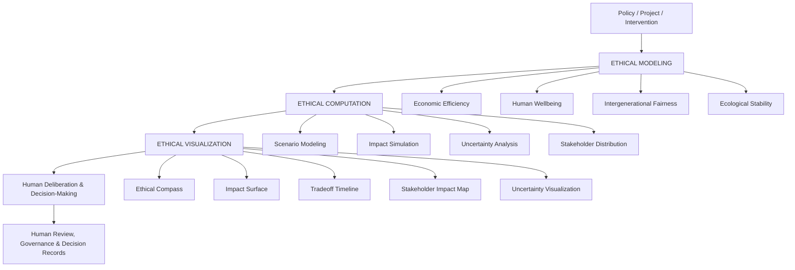
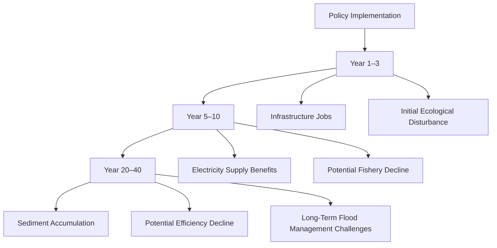
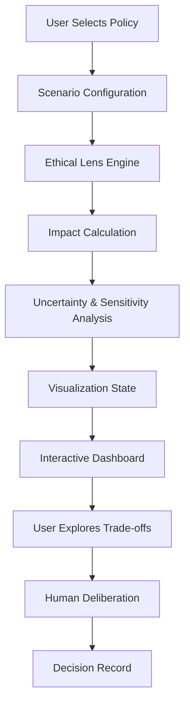

# 🧭 Atlas Sanctum | Ethical Reasoning Models
### A Multi-Lens Intelligence Engine for Ethical Decision-Making

**See the Consequences. Understand the Trade-offs. Choose the Direction.**

The Ethical Reasoning Models layer is an intelligence and visualization engine within **Atlas Sanctum**, designed to help governments, institutions, businesses, researchers, and communities understand the ethical consequences of complex decisions.

It brings together moral philosophy, economics, ecological science, social wellbeing, systems thinking, and computational modeling to reveal the multidimensional consequences of policies, investments, and development interventions.

Rather than producing a single moral verdict, Atlas evaluates decisions through multiple ethical perspectives, visualizes competing outcomes, models long-term consequences, and exposes uncertainty.

> **The machine reveals the terrain. Humans remain responsible for choosing the direction.**

---

## 🌍 1. The Vision: From Data Intelligence to Ethical Intelligence

Modern decision-making systems are increasingly capable of optimizing economic performance, predicting environmental change, and modeling social outcomes.

Yet a fundamental challenge remains:

**How do we understand whether a decision creates progress across the full spectrum of human and planetary wellbeing?**

A policy may increase GDP while displacing communities. An infrastructure project may improve energy security while damaging biodiversity. An investment may generate immediate returns while transferring environmental costs to future generations.

Traditional analytics often reduce these complex decisions to isolated indicators.

Atlas takes a different approach.

It introduces a multi-lens ethical reasoning architecture that makes competing values, consequences, uncertainties, and stakeholder experiences visible.

### Core Design Principles

- **Plurality over single-score optimization:** Preserve distinct ethical dimensions instead of hiding them inside one aggregate score.
- **Transparency over opaque recommendations:** Show assumptions, evidence, uncertainty, and competing outcomes.
- **Long-term thinking over short-term optimization:** Model consequences across generations.
- **Human accountability over automated moral authority:** AI supports deliberation but does not replace legitimate human decision-making.
- **Ecological and social awareness:** Evaluate economic performance alongside human and planetary wellbeing.

---

## 🏛️ 2. System Architecture: Three Intelligence Layers

The Ethical Reasoning Models layer is organized around three foundational systems.



### Layer 01: Ethical Modeling

Defines the ethical frameworks, value dimensions, measurable indicators, and assumptions used to evaluate decisions.

### Layer 02: Ethical Computation

Processes evidence, computes impact measures, compares scenarios, and models potential outcomes across time.

### Layer 03: Ethical Visualization

Transforms complex analytical outputs into intuitive interfaces that enable users to understand the consequences of decisions.

---

## 🧠 3. The Ethical Lens Engine

**Multiple perspectives. One shared decision landscape.**

The Ethical Lens Engine evaluates policies and interventions using four primary ethical dimensions.

Each lens represents a distinct analytical perspective with its own indicators, scoring methodology, evidence requirements, and uncertainty profile.

### 3.1 Economic Efficiency Lens

Examines economic performance, resource allocation, productivity, and financial sustainability.

**Evaluation dimensions:**
- GDP and productivity impact.
- Capital formation.
- Employment generation.
- Market stability.
- Infrastructure efficiency.
- Resource allocation.
- Long-term economic resilience.

**Example question:**

Does the proposed infrastructure investment generate sustainable economic value, or does it transfer costs elsewhere?

### 3.2 Human Wellbeing Lens

Evaluates how decisions affect people's lives, opportunities, dignity, and access to essential services.

**Evaluation dimensions:**
- Public health outcomes.
- Education accessibility.
- Employment opportunities.
- Poverty and inequality.
- Housing security.
- Community displacement.
- Quality of life.
- Access to essential infrastructure.

**Example question:**

Who experiences improved living conditions, and who may become more vulnerable?

### 3.3 Intergenerational Fairness Lens

Examines how present decisions influence the opportunities and resources available to future populations.

**Evaluation dimensions:**
- Long-term climate impacts.
- Natural resource depletion.
- Public debt burdens.
- Infrastructure longevity.
- Ecosystem inheritance.
- Future economic opportunities.
- Long-term environmental liabilities.

**Example question:**

Are today's benefits being purchased through costs that future generations will have to carry?

### 3.4 Ecological Stability Lens

Evaluates the health, resilience, and regenerative capacity of natural systems.

**Evaluation dimensions:**
- Biodiversity preservation.
- Ecosystem resilience.
- Carbon cycle impacts.
- Water security.
- Land degradation.
- Habitat fragmentation.
- Pollution exposure.
- Natural resource regeneration.

**Example question:**

Does this intervention strengthen the ecosystems that support human civilization, or weaken them?

### Ethical Lens Comparison

| Ethical Lens | Primary Focus | Example Indicators |
|---|---|---|
| Economic Efficiency | Prosperity | Productivity, employment, investment |
| Human Wellbeing | Human flourishing | Health, equity, education |
| Intergenerational Fairness | Future opportunities | Climate liabilities, resource depletion |
| Ecological Stability | Planetary resilience | Biodiversity, water, land health |

**Engineering principle:** Each lens produces a distinct set of outputs. A composite index may be provided as an optional analytical view, but it must never conceal the underlying dimensions or imply that all values are interchangeable.

---

## 📐 4. The Ethical Impact Surface

**Visualizing the geometry of competing outcomes.**

The Ethical Impact Surface represents the multidimensional consequences of policies, investments, and interventions.

Instead of presenting users with a simple recommended option, the interface visualizes where different scenarios sit across competing value domains.

### Primary Analytical Dimensions

1. Economic growth.
2. Human wellbeing.
3. Ecosystem health.
4. Intergenerational cost.

Each proposed intervention becomes a scenario represented by a collection of measurable outcomes.

### Example: Dam Construction vs. Wetland Restoration

Consider two possible interventions within a river basin.

**Scenario A: Dam Construction**

| Dimension | Illustrative Assessment |
|---|---|
| Economic Growth | High potential |
| Electricity Generation | High potential |
| Human Displacement | Moderate to high risk |
| Ecosystem Damage | Potentially high |
| Long-Term Energy Benefits | Potentially high |

**Scenario B: Wetland Restoration**

| Dimension | Illustrative Assessment |
|---|---|
| Economic Growth | Moderate potential |
| Electricity Generation | None |
| Flood Protection | Moderate to high potential |
| Ecosystem Restoration | High potential |
| Long-Term Ecological Benefits | Potentially high |

*These are conceptual scenarios, not measured results or universal assessments. Actual performance depends on site-specific evidence and engineering studies.*

### Frontend Visualization

The Ethical Impact Surface should offer:

- Multidimensional radar charts.
- Interactive scenario comparisons.
- Parallel coordinate visualizations.
- Trade-off scatter plots.
- Impact distribution views.
- Expandable evidence panels.

Users should be able to select a scenario, inspect individual indicators, compare alternatives, and understand why the scenario occupies a particular position.

### Core Interaction

When a user selects a policy scenario:

1. The visualization highlights its impact dimensions.
2. Associated indicators appear.
3. Evidence and assumptions become accessible.
4. Competing scenarios are displayed.
5. The user can inspect trade-offs without receiving an automatically imposed moral verdict.

---

## ⏳ 5. The Tradeoff Simulator

**Decisions unfold across time. Ethical consequences must too.**

The Tradeoff Simulator models how the consequences of an intervention may evolve across multiple time horizons.

Short-term improvements can create long-term vulnerabilities. Conversely, investments with modest immediate returns may produce substantial future benefits.

### Example: Infrastructure Decision Timeline



### Timeline Visualization Features

- Configurable simulation horizons.
- Year-by-year or decade-based views.
- Short-term and long-term impact indicators.
- Cumulative impact curves.
- Scenario comparison over time.
- Environmental and social impact events.
- Uncertainty bands.
- Milestone annotations.

### User Interaction

Users should be able to:

- Drag across a timeline.
- Compare different time horizons.
- Pause at important impact milestones.
- Switch between stakeholder perspectives.
- Inspect assumptions behind projections.
- Compare alternative policy interventions.

**Key principle:** The interface must distinguish observed historical evidence from modeled future projections.

---

## 👥 6. Stakeholder Impact Mapping

**Ethics becomes concrete when we understand who experiences the consequences.**

Policies rarely affect everyone equally.

Stakeholder Impact Mapping identifies the distribution of benefits, costs, risks, and opportunities across affected populations and ecological systems.

### Stakeholder Categories

**Urban Residents**
- Energy availability.
- Air quality.
- Housing affordability.
- Employment opportunities.

**Rural Farmers**
- Land access.
- Water availability.
- Agricultural productivity.
- Livelihood security.

**Indigenous Communities**
- Cultural heritage.
- Land rights.
- Resource access.
- Community autonomy.

**Future Generations**
- Climate stability.
- Natural resource availability.
- Public debt.
- Environmental inheritance.

**Ecosystems**
- Biodiversity.
- Habitat connectivity.
- Water quality.
- Ecological resilience.

### Stakeholder Mapping Interface

The dashboard should include:

- Geographic impact maps.
- Population impact comparisons.
- Distributional equity charts.
- Benefit and burden indicators.
- Community-level evidence panels.
- Stakeholder-specific scenario filters.

### Example: Distributional Impact Analysis

A proposed dam project could provide electricity to urban populations while creating displacement risks for rural communities.

The system should expose both outcomes.

A carbon tax could reduce emissions while increasing transportation costs for low-income households.

The system should expose both outcomes.

The objective is not to assume that every intervention creates injustice. It is to identify who benefits, who bears the costs, and where protective measures may be necessary.

---

## 🌫️ 7. Ethical Uncertainty Modeling

**Scientific humility is a core feature, not an afterthought.**

Ethical analysis frequently depends on incomplete information, uncertain forecasts, competing methodologies, and assumptions about future conditions.

Atlas therefore treats uncertainty as a first-class analytical dimension.

### Uncertainty Indicators

| Indicator | Purpose |
|---|---|
| Confidence Intervals | Display the range of plausible modeled outcomes. |
| Data Completeness | Reveal missing or incomplete evidence. |
| Model Disagreement | Identify differences between analytical models. |
| Assumption Sensitivity | Show which assumptions materially influence results. |
| Evidence Quality | Identify the reliability and provenance of supporting information. |

### Visualization Features

- Confidence interval charts.
- Data completeness indicators.
- Model disagreement panels.
- Sensitivity analysis sliders.
- Evidence quality labels.
- Scenario confidence comparisons.

### Illustrative Example

A proposed industrial development might show:

- Economic growth estimate: positive, with moderate confidence.
- Biodiversity impact: potentially negative, with low confidence.
- Employment estimate: positive, with high confidence.
- Water availability impact: uncertain due to limited hydrological data.

The dashboard should make these differences visible rather than presenting all findings with equal certainty.

---

## 🧭 8. Ethical Diversity Mode

**Different value systems. Transparent assumptions. Human choice.**

Societies and institutions do not always prioritize ethical values identically.

Ethical Diversity Mode allows authorized users to explore how different value priorities affect scenario comparisons.

### Configurable Value Priorities

- Ecological harmony.
- Economic development.
- Social equity.
- Intergenerational responsibility.
- Human wellbeing.
- Institutional resilience.

### Interactive Weight Configuration

Users can adjust value weights to explore different policy perspectives.

Example:

| Value Dimension | Development-Oriented | Equity-Oriented | Ecological-Oriented |
|---|---:|---:|---:|
| Economic Efficiency | 40% | 20% | 15% |
| Human Wellbeing | 25% | 40% | 20% |
| Intergenerational Fairness | 15% | 20% | 25% |
| Ecological Stability | 20% | 20% | 40% |
| Total | 100% | 100% | 100% |

*Illustrative configurations for demonstrating sensitivity to priorities, not universal cultural classifications.*

### Important Design Safeguards

- Never present one configuration as morally superior by default.
- Make weighting assumptions visible.
- Allow users to compare multiple configurations.
- Preserve unweighted underlying indicators.
- Show how rankings change when priorities change.
- Record who configured the model and when.
- Avoid assigning ethical preferences to entire cultures without evidence or consent.

This makes value disagreement inspectable rather than disguising it as objective computational certainty.

---

## 🎨 9. The Ethical Reasoning Dashboard

The frontend translates sophisticated analytical models into an intuitive decision-support environment.

It should feel less like a conventional spreadsheet and more like an interactive landscape for exploring consequences.

### Core Dashboard Layout

```text
┌──────────────────────────────────────────────────────────────┐
│ ATLAS SANCTUM                         ETHICAL INTELLIGENCE    │
├──────────────────────────────────────────────────────────────┤
│                                                              │
│  ETHICAL REASONING MODELS                                    │
│  Explore the multidimensional consequences of decisions.    │
│                                                              │
├──────────────────────────────────────────────────────────────┤
│                                                              │
│  [ ECONOMIC ]  [ HUMAN ]  [ FUTURE ]  [ ECOLOGICAL ]          │
│                                                              │
├──────────────────────────────────────────────────────────────┤
│                                                              │
│  ETHICAL COMPASS                                             │
│  Visual representation of competing value dimensions        │
│                                                              │
├──────────────────────────────────────────────────────────────┤
│                                                              │
│  ETHICAL IMPACT SURFACE                                      │
│  Compare scenarios across multidimensional outcomes          │
│                                                              │
├──────────────────────────────────────────────────────────────┤
│                                                              │
│  TRADEOFF SIMULATOR                                          │
│  Explore consequences across decades                         │
│                                                              │
├──────────────────────────────────────────────────────────────┤
│                                                              │
│  STAKEHOLDER IMPACT MAP                                      │
│  Understand the distribution of benefits and burdens         │
│                                                              │
├──────────────────────────────────────────────────────────────┤
│                                                              │
│  UNCERTAINTY & EVIDENCE                                      │
│  Confidence | Data gaps | Model disagreements                │
│                                                              │
├──────────────────────────────────────────────────────────────┤
│                                                              │
│  HUMAN DELIBERATION                                          │
│  Review findings | Record decisions | Document reasoning      │
│                                                              │
└──────────────────────────────────────────────────────────────┘
```

### Primary Visualization Components

**1. Ethical Compass**

An interactive radial visualization displaying the directional influence of competing value dimensions.

**2. Tradeoff Terrain**

A conceptual landscape showing the relative positions of alternative policy scenarios.

**3. Stakeholder Impact Map**

An interactive geographical and social distribution visualization.

**4. Temporal Impact Ribbon**

A chronological representation of how consequences evolve over years and decades.

**5. Uncertainty Observatory**

A dedicated evidence and confidence interface showing what is known, modeled, disputed, and missing.

---

## 💻 10. Frontend Engineering Architecture

The platform should use a modular, reusable component architecture that separates ethical modeling logic, computational outputs, and visualization components.

### Proposed Technology Stack

| Layer | Technology |
|---|---|
| Frontend Framework | React |
| Language | TypeScript |
| Build System | Vite |
| Styling | Tailwind CSS |
| UI Components | shadcn/ui |
| Icons | Lucide React |
| Data Visualization | Recharts |
| Advanced Visualizations | D3.js |
| Motion | Framer Motion |
| Mapping | Mapbox GL JS or MapLibre |
| State Management | Zustand |
| Data Fetching | TanStack Query |
| Backend / Database | Supabase / PostgreSQL |
| Simulation Services | Python |
| AI Integration | LLM APIs and analytical models |
| Testing | Vitest, React Testing Library, Playwright |
| Deployment | Vercel |

### Suggested Project Structure

```text
src/
│
├── app/
│   ├── App.tsx
│   ├── routes/
│   └── providers/
│
├── components/
│   ├── layout/
│   │   ├── DashboardLayout.tsx
│   │   ├── Sidebar.tsx
│   │   ├── Header.tsx
│   │   └── Navigation.tsx
│   │
│   ├── ui/
│   │
│   └── visualizations/
│       ├── EthicalCompass.tsx
│       ├── EthicalImpactSurface.tsx
│       ├── TradeoffTerrain.tsx
│       ├── StakeholderImpactMap.tsx
│       ├── TemporalImpactRibbon.tsx
│       └── UncertaintyVisualization.tsx
│
├── features/
│   └── ethical-reasoning/
│       ├── components/
│       │   ├── LensSelector.tsx
│       │   ├── EthicalLensCard.tsx
│       │   ├── ScenarioComparison.tsx
│       │   ├── WeightConfiguration.tsx
│       │   ├── EvidencePanel.tsx
│       │   └── DeliberationPanel.tsx
│       │
│       ├── engines/
│       │   ├── ethicalLensEngine.ts
│       │   ├── impactCalculationEngine.ts
│       │   ├── scenarioEngine.ts
│       │   └── uncertaintyEngine.ts
│       │
│       ├── hooks/
│       │   ├── useEthicalModels.ts
│       │   ├── useScenarioSimulation.ts
│       │   └── useEthicalWeights.ts
│       │
│       ├── data/
│       │   ├── demoScenarios.ts
│       │   ├── ethicalFrameworks.ts
│       │   └── sampleImpacts.ts
│       │
│       ├── types/
│       │   └── ethical-models.ts
│       │
│       └── utils/
│           ├── scoring.ts
│           ├── normalization.ts
│           └── uncertainty.ts
│
├── services/
│   ├── api.ts
│   ├── simulationService.ts
│   └── evidenceService.ts
│
├── stores/
│   └── ethicalReasoningStore.ts
│
└── styles/
    └── globals.css
```

---

## 🧩 11. Core TypeScript Data Models

The frontend should operate on structured, typed analytical data rather than hardcoded visualization values.

### Ethical Dimensions

```typescript
export type EthicalDimension =
  | "economic_efficiency"
  | "human_wellbeing"
  | "intergenerational_fairness"
  | "ecological_stability";

export interface EthicalLens {
  id: EthicalDimension;
  name: string;
  description: string;
  indicators: EthicalIndicator[];
}

export interface EthicalIndicator {
  id: string;
  name: string;
  unit: string;
  description: string;

  value: number;
  normalizedValue?: number;

  direction: "positive" | "negative" | "neutral";

  confidence?: {
    lower: number;
    upper: number;
    level: number;
  };

  evidenceIds: string[];
}
```

### Policy Scenario

```typescript
export interface PolicyScenario {
  id: string;
  name: string;
  description: string;

  category: string;

  dimensions: Record<
    EthicalDimension,
    number
  >;

  indicators: EthicalIndicator[];

  timeHorizon: {
    startYear: number;
    endYear: number;
  };

  assumptions: string[];

  evidenceIds: string[];

  uncertaintyLevel:
    | "low"
    | "moderate"
    | "high";
}
```

### Stakeholder Impact

```typescript
export interface StakeholderImpact {
  id: string;
  name: string;

  category:
    | "urban_residents"
    | "rural_farmers"
    | "indigenous_communities"
    | "future_generations"
    | "ecosystems";

  benefits: ImpactMeasure[];
  burdens: ImpactMeasure[];

  affectedPopulation?: number;

  geographicReference?: {
    latitude: number;
    longitude: number;
  };

  evidenceIds: string[];
}

export interface ImpactMeasure {
  indicator: string;
  value: number;
  unit: string;
  direction: "positive" | "negative";
}
```

### Ethical Weight Configuration

```typescript
export interface EthicalWeightConfiguration {
  id: string;
  name: string;

  weights: Record<
    EthicalDimension,
    number
  >;

  description: string;
  createdAt: string;
}
```

Weights should be normalized and validated before any weighted comparison is calculated.

### Evidence and Provenance

```typescript
export interface EvidenceRecord {
  id: string;
  title: string;

  source: string;
  sourceType:
    | "research"
    | "government"
    | "community"
    | "dataset"
    | "simulation";

  publishedAt?: string;

  verified: boolean;

  methodology?: string;
  limitations: string[];

  confidence?: number;
}
```

---

## ⚙️ 12. Ethical Computation & Scoring

The computation engine must preserve analytical transparency.

A basic weighted comparison model may calculate:

\[
S = \sum_{i=1}^{n} w_i x_i
\]

Where:

- \(S\) = weighted analytical score.
- \(w_i\) = configured weight for dimension \(i\).
- \(x_i\) = normalized indicator value.
- \(n\) = number of dimensions.

Subject to:

\[
\sum_{i=1}^{n} w_i = 1
\]

This formula supports optional comparisons, but it does not define moral truth.

### Engineering Requirements

- Normalize heterogeneous measurement units.
- Define beneficial and harmful indicator directions.
- Preserve underlying raw measurements.
- Display missing data explicitly.
- Validate configuration weights.
- Prevent incompatible indicators from being combined without justification.
- Expose assumptions and calculation methodology.
- Support sensitivity analysis.
- Preserve individual dimension scores.

### Example TypeScript Utility

```typescript
import type {
  EthicalDimension,
  EthicalWeightConfiguration,
} from "../types/ethical-models";

export function calculateWeightedScore(
  values: Record<EthicalDimension, number>,
  configuration: EthicalWeightConfiguration
): number {
  const dimensions = Object.keys(
    configuration.weights
  ) as EthicalDimension[];

  const totalWeight = dimensions.reduce(
    (sum, dimension) =>
      sum + configuration.weights[dimension],
    0
  );

  if (Math.abs(totalWeight - 1) > 0.000001) {
    throw new Error(
      "Ethical weights must sum to 1."
    );
  }

  for (const dimension of dimensions) {
    const value = values[dimension];
    const weight = configuration.weights[dimension];

    if (!Number.isFinite(value)) {
      throw new Error(
        `Invalid value for ${dimension}`
      );
    }

    if (!Number.isFinite(weight) || weight < 0) {
      throw new Error(
        `Invalid weight for ${dimension}`
      );
    }
  }

  return dimensions.reduce(
    (score, dimension) =>
      score +
      values[dimension] *
        configuration.weights[dimension],
    0
  );
}
```

*This utility demonstrates a basic weighted calculation. Production scoring requires documented normalization, indicator direction, missing-data handling, and uncertainty propagation.*

---

## 🔄 13. Data Flow & Interaction Architecture

The application should follow a clear and traceable data flow.



### Interaction Requirements

- Scenario selection updates relevant visualizations.
- Lens selection changes the active analytical perspective.
- Time-horizon controls update temporal views.
- Stakeholder filters update distributional analysis.
- Weight sliders recalculate optional weighted comparisons.
- Evidence panels expose provenance and methodological limitations.
- Scenario comparisons preserve the independent underlying data.
- Human decision records document reasoning and approval authority.

---

## 🛡️ 14. Ethical AI Governance

Atlas must not confuse computational consistency with moral legitimacy.

The Ethical Reasoning Models layer is a decision-support system, not an autonomous moral authority.

### Governance Requirements

**Explainability**
- Display why indicators change.
- Show contributing variables.
- Provide accessible evidence references.

**Human Accountability**
- Keep consequential decisions under legitimate human authority.
- Record human approvals and disagreements.
- Allow authorized reviewers to challenge model assumptions.

**Fairness**
- Examine impacts across demographic and geographic groups where appropriate and lawful.
- Test for systematic bias.
- Avoid treating aggregated population estimates as individual outcomes.

**Transparency**
- Distinguish measured observations from modeled projections.
- Display confidence and data limitations.
- Make value configurations inspectable.

**Pluralism**
- Support multiple ethical frameworks.
- Preserve disagreement between different perspectives.
- Avoid presenting configured value weights as universal moral standards.

**Privacy**
- Minimize personal and community-level data collection.
- Apply appropriate aggregation and access controls.
- Protect sensitive stakeholder information.

---

## 🚀 15. Development Roadmap

### Phase 1: Ethical Intelligence Interface
- [ ] Build dashboard shell and navigation.
- [ ] Implement four ethical lens cards.
- [ ] Create Ethical Compass visualization.
- [ ] Develop scenario selection interface.
- [ ] Add sample policy scenarios.
- [ ] Implement responsive layouts.
- [ ] Add dark and light themes.

### Phase 2: Ethical Impact Visualization
- [ ] Build Ethical Impact Surface.
- [ ] Implement multidimensional comparisons.
- [ ] Add Tradeoff Terrain visualization.
- [ ] Develop Temporal Impact Ribbon.
- [ ] Add Stakeholder Impact Mapping.
- [ ] Implement evidence detail panels.

### Phase 3: Computational Intelligence
- [ ] Implement ethical scoring utilities.
- [ ] Add indicator normalization.
- [ ] Build scenario comparison engine.
- [ ] Implement configurable weights.
- [ ] Add sensitivity analysis.
- [ ] Develop uncertainty visualization.
- [ ] Integrate simulation APIs.

### Phase 4: Evidence & Governance
- [ ] Build evidence provenance system.
- [ ] Add model methodology documentation.
- [ ] Implement human review workflows.
- [ ] Record decision histories.
- [ ] Add access control.
- [ ] Implement audit logging.

### Phase 5: Atlas Ecosystem Integration
- [ ] Integrate Atlas Knowledge Graph.
- [ ] Connect environmental intelligence datasets.
- [ ] Connect economic and social indicators.
- [ ] Integrate geographic information systems.
- [ ] Connect Atlas AI orchestration.
- [ ] Enable cross-domain policy simulations.

---

## 🌐 16. Real-World Applications

The Ethical Reasoning Models layer is designed to support decisions across interconnected human and planetary systems.

| Sector | Decision-Support Application |
|---|---|
| Public Governance | Evaluate infrastructure and development policies. |
| Climate & Environment | Compare conservation and adaptation interventions. |
| Agriculture | Examine land use, water allocation, and food security. |
| Urban Planning | Evaluate housing, transportation, and urban regeneration. |
| Energy | Compare energy transition strategies and distributional impacts. |
| Healthcare | Explore resource allocation and population wellbeing. |
| Finance | Examine long-term social and ecological investment impacts. |
| Education | Assess equitable access and intergenerational opportunity. |

### Example: Urban Development

A city government is considering a major urban expansion project.

Atlas can help decision-makers explore:

- Economic development potential.
- Affordable housing accessibility.
- Displacement risks.
- Water and energy requirements.
- Biodiversity and land-use impacts.
- Long-term infrastructure liabilities.
- Differences in outcomes between affected communities.

Rather than automatically recommending approval or rejection, the platform reveals the implications of each alternative and the evidence behind them.

---

## 📈 17. Success Criteria

The project should be evaluated through measurable engineering and analytical outcomes.

| Area | Success Measure |
|---|---|
| Usability | Users can navigate all four ethical lenses. |
| Transparency | Every displayed assessment has traceable assumptions and evidence. |
| Interactivity | Scenario changes propagate consistently across relevant visualizations. |
| Computation | Scoring and normalization functions pass automated tests. |
| Uncertainty | Missing data and confidence limitations remain visible. |
| Accessibility | Interfaces support keyboard navigation and readable contrast. |
| Performance | Large analytical datasets can be explored responsively. |
| Governance | Human decisions and model configurations can be audited. |

---

## 🤝 18. Contributing

We welcome contributions from:

- Frontend engineers.
- AI and machine learning researchers.
- Philosophers and ethicists.
- Climate and ecological scientists.
- Economists.
- Social scientists.
- Data visualization specialists.
- Public policy researchers.
- Governance and institutional design experts.

### Contribution Areas

- Ethical modeling frameworks.
- Indicator design and normalization.
- Interactive data visualizations.
- Scenario simulation.
- Evidence provenance.
- Accessibility and usability.
- AI transparency and governance.

### Development Workflow

1. Fork the repository.
2. Create a feature branch.
3. Implement the required functionality.
4. Add appropriate tests.
5. Document assumptions and limitations.
6. Submit a pull request.

---

## 📜 19. License

Add the appropriate open-source license once the project's licensing and contribution terms have been established.

---

# ✨ The Larger Vision: A Civilizational Decision Mirror

The Ethical Reasoning Models layer represents a deeper evolution in how intelligence systems can support humanity.

We have developed increasingly powerful tools to measure production, optimize resources, predict markets, and simulate physical systems.

But the ability to measure something does not automatically tell us whether pursuing it is wise.

Atlas introduces a different kind of intelligence interface.

It allows leaders to examine economic prosperity alongside human dignity, environmental resilience, and the responsibilities owed to future generations.

It does not conceal disagreement behind a universal score.

It does not mistake prediction for certainty.

It does not transfer moral responsibility to an algorithm.

Instead, it creates a navigable environment for understanding consequences.

**Atlas becomes the map. Humans still choose the direction.**

---

**ATLAS SANCTUM**

*Intelligence in Service of Life.*

*See the System. Understand the Consequences. Choose with Discernment.*
